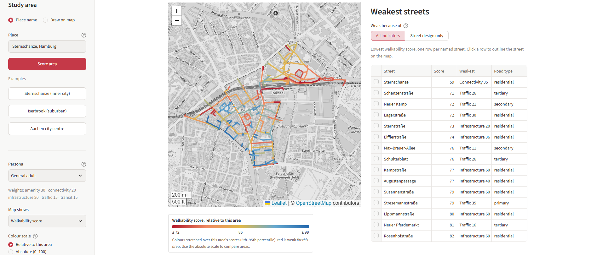

# WalkScope

WalkScope scores every street in a neighbourhood from 0 to 100 for walkability, using OpenStreetMap data and different people's needs, and lets you test what a new crossing or shop would change.



**Live demo:** _link to follow_

## What it does

- **Street-by-street scoring.** Type a place name and the app downloads its OpenStreetMap data. It then scores every street segment on five indicators and shows the result on a map, with a table of the weakest named streets.
- **Personas.** Four personas: general adult, wheelchair user, child walking to school, and night-time. Each one weights the indicators differently. Some also use extra data, such as kerbs and surface for the wheelchair persona and lighting for night-time.
- **What-if scenarios.** Add a marked crossing or an amenity (groceries, school, pharmacy, park, café, doctor) by clicking the map. Only the affected streets are rescored, in about 0.05 s. The app shows how many streets improved and the road average before and after.
- **Drawn areas.** Instead of a place name, draw a polygon or rectangle on the map (up to 5 km²).
- **Report.** A one-page report as PDF or Markdown. It has the map, the averages, each indicator, the weakest streets, data completeness and any what-if scenario.
- **Data completeness.** The app shows how much of the network has sidewalk, kerb, lighting and speed-limit tags. It warns when the selected persona relies on data that is mostly missing.
- **Example areas.** Sternschanze and Iserbrook (Hamburg) and Aachen city centre ship with their map data, so they open in 5–6 s without a download.

## How the score works

Each street segment gets five indicator scores from 0 to 100. Its walkability score is their weighted average, with weights set by the persona. The full method is in [docs/method.md](docs/method.md). Every threshold and default is in `config/indicators.yaml`, and the persona weights are in `config/personas.yaml`.

| Indicator | What it measures |
| --- | --- |
| Amenity access | Walking distance along the network to the nearest of six everyday categories. Each scores 100 within 200 m, falling to 0 at 800 m. |
| Connectivity | Road intersections per km² within 400 m (30 → 0 points, 150 → 100 points) |
| Pedestrian infrastructure | Sidewalk (60 %) and a marked crossing within 50 m (40 %). Footways and paths score 100. Kerbs, surface and lighting are added for some personas. |
| Traffic stress | Speed limit, scaled by a road-class factor, minus 10 points per lane above two |
| Transit access | Walking distance to the nearest stop (100 within 150 m, 0 at 800 m) or rail station (100 within 300 m, 0 at 1,000 m), whichever scores better |

Persona weights (each row sums to 100; a starting point, still to be tuned):

| Persona | Amenity | Connectivity | Infrastructure | Traffic stress | Transit |
| --- | --- | --- | --- | --- | --- |
| General adult | 30 | 20 | 20 | 15 | 15 |
| Wheelchair user | 20 | 10 | 40 | 15 | 15 |
| Child walking to school | 20 | 10 | 25 | 35 | 10 |
| Night-time | 20 | 15 | 35 | 15 | 15 |

For the wheelchair persona, steps score 0.

### Key method decisions

- **Separately mapped sidewalks.** Roads tagged `sidewalk=separate` are kept and scored, and their separate sidewalk ways are used only for routing. OSMnx's walking network drops these roads, which in Berlin removed nearly every street and left only sidewalks that scored 100.
- **Residential default of 30 km/h.** A residential street without a speed tag is assumed to be 30 km/h, not the legal 50 km/h. Among tagged residential streets in four German test areas, 85–100 % are 30 km/h or lower.
- **Road-class factor.** The speed score is multiplied by a factor for the road class (primary 0.6, residential 1.0), because OSM has no traffic counts and the road class is the best available stand-in for traffic volume.
- **Distance decay.** Amenity and transit scores fall linearly with walking distance instead of passing or failing at a cut-off. With a single cut-off, every street in central areas scored 100.
- **Length-weighted, road-only averages.** Area figures are weighted by segment length, because OSMnx splits streets at every junction. The headline average leaves out footways and paths: they score 100 on traffic and infrastructure by definition and would push the average up whatever the roads are like. They are reported separately.
- **Relative colour scale.** By default the map colours are stretched over the area's own 5th–95th percentile, so the weakest streets in the area show red even where every score is high. An absolute 0–100 scale is available for comparing areas.

## Limitations

- **OpenStreetMap data completeness.** Sidewalk, kerb and lighting tags are missing in many cities. A missing tag scores 50 (unknown), and the app shows the share of the network where the data is known, so a low score caused by missing data can be told apart from a bad street.
- **Dependence on the public Overpass server.** New areas are downloaded from overpass-api.de. Measured on 2026-11-16, the street network took about 70 s and the shops, stops and crossings 105–181 s, so a new area takes about 3–5 minutes. Scoring then takes 3–4 s. When the server is busy, a download can take up to 10 minutes or fail. The app shows live progress, retries, and points to the example areas. A different server can be set with the `WALKSCOPE_OVERPASS_URL` environment variable.
- **Validation still pending.** The scores have not yet been checked against an independent measure, such as pedestrian counts. The persona weights are a starting point.

## Run it locally (Windows)

Needs Python 3.11 or later.

```powershell
git clone https://github.com/monu221/WalkScope.git
cd WalkScope
py -m venv .venv
.venv\Scripts\Activate.ps1
pip install -e ".[dev]"
streamlit run app/streamlit_app.py
```

The app opens at <http://localhost:8501>. Downloaded areas are cached in `data/cache/`.

Run the tests (offline, on small fixtures):

```powershell
pytest
```

The tests that call the real Nominatim and Overpass APIs are skipped by default; run them with `pytest -m live`.

## Deploy on Streamlit Community Cloud

- **Main file path:** `app/streamlit_app.py`
- **Python version:** 3.12, chosen under *Advanced settings* when deploying (Community Cloud has no file for this; 3.12 is its default).
- **Dependencies:** `requirements.txt` installs the package (`.`) with the library versions the bundled examples were saved with.
- **Cache:** downloads are cached in `data/cache/`, or in the temp directory if that can't be written to (set `WALKSCOPE_CACHE_DIR` to choose another). The disk is temporary, so the cache may be empty after a restart and new areas are downloaded again. The example areas always load from `data/examples/` without any server call.

## Licences

- **Code:** MIT, see [LICENSE](LICENSE).
- **Map data:** the bundled example data in `data/examples/` and any data the app downloads is © OpenStreetMap contributors, under the [Open Database License (ODbL) 1.0](https://opendatacommons.org/licenses/odbl/1-0/), not MIT. See [data/examples/README.md](data/examples/README.md) and <https://www.openstreetmap.org/copyright>.

## Roadmap

- **Validation:** correlate the scores for one city with an independent measure such as pedestrian counts.
- **Lighter Overpass query:** download crossings and kerbs as nodes only, use one statement per tag key, and query a bounding box instead of the polygon, to shorten the slowest request. These cuts leave the scores unchanged; how much faster they are is still to be measured (see [docs/plan.md](docs/plan.md)).
- **Fallback server:** try a second Overpass server when the main one stays busy, after checking it returns the same data.
